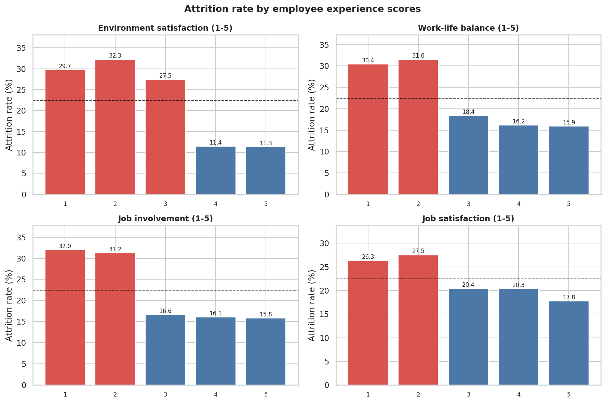
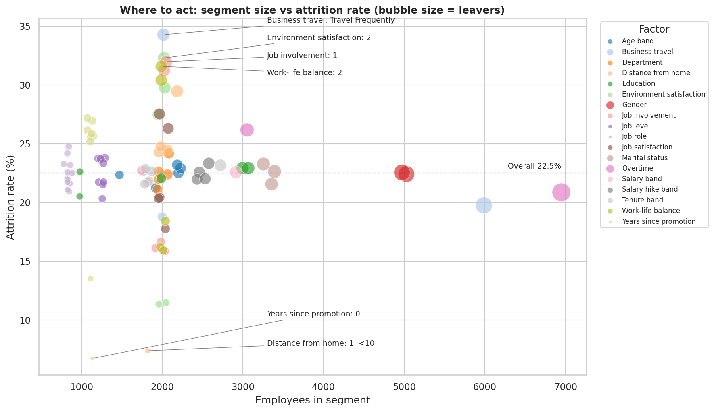
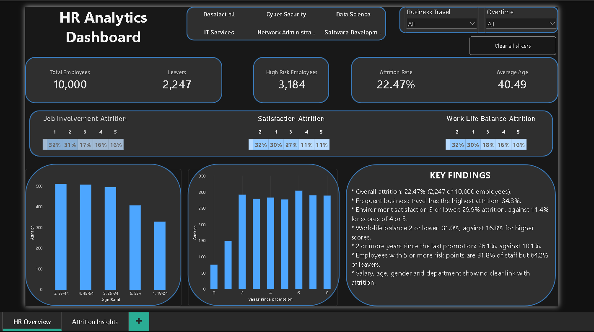
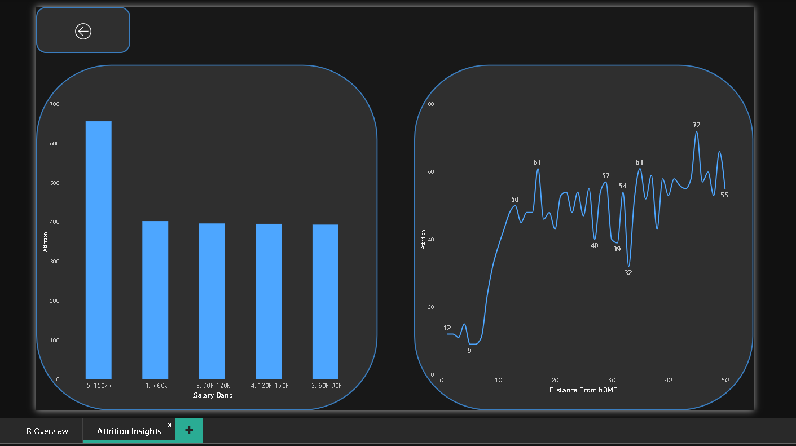
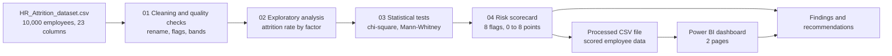
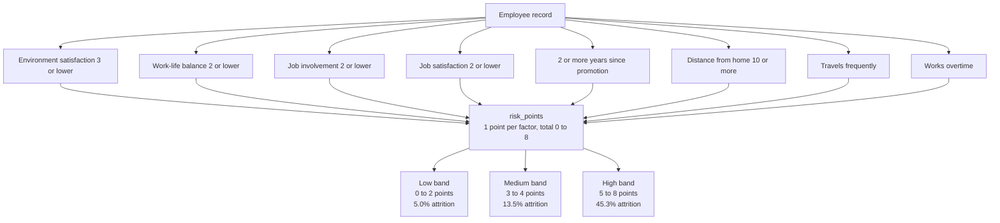
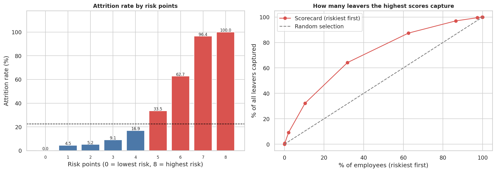

# Employee Attrition Analysis (Python + Power BI)


Why do employees leave, and which employees should HR focus on first?

This project analyses **10,000 employee records** in Python (cleaning, exploration, statistical tests, a risk scorecard) and presents the results in a two-page Power BI dashboard. A scatter plot of high-risk segments is in notebook 02.

## At a glance

| | |
|---|---|
| **Business question** | Which employees and conditions are linked to attrition, and where should HR act first? |
| **Data** | 10,000 employees, 23 columns, 2,247 leavers (22.47% attrition) |
| **Tools** | Python (pandas, matplotlib, seaborn, scipy, scikit-learn), Jupyter, Power BI (DAX) |
| **Headline result** | Employees with **5 or more risk points** are 31.8% of staff but 64.2% of leavers. Pay, age, gender and department show **no reliable link** with attrition |

## Key charts





## Dashboard

The Power BI file is [`powerbi/hr_attrition_dashboard.pbix`](powerbi/hr_attrition_dashboard.pbix). The data model, measures and page details are in [`powerbi/README.md`](powerbi/README.md).

**Page 1: HR Overview**



**Page 2: Attrition Insights**



## Project workflow



## Key findings

Overall: **2,247 of 10,000 employees left (22.47%)**.

**1. Workplace conditions matter, pay does not.**

| Factor | Higher-risk group | Comparison group | Gap (pts) |
|---|---|---|---|
| Business travel | Travels frequently: **34.3%** | Other: 19.5% | +14.8 |
| Environment satisfaction | 3 or lower: **29.9%** | 4 or 5: 11.4% | +18.5 |
| Work-life balance | 2 or lower: **31.0%** | 3 or higher: 16.8% | +14.1 |
| Job involvement | 2 or lower: **31.6%** | 3 or higher: 16.2% | +15.4 |
| Years since last promotion | 2 or more: **26.1%** | Less than 2: 10.1% | +16.0 |
| Distance from home (unit not stated) | 10 or more: **25.8%** | Under 10: 7.4% | +18.4 |
| Job satisfaction | 2 or lower: **26.9%** | 3 or higher: 19.5% | +7.4 |
| Overtime | Yes: **26.2%** | No: 20.9% | +5.3 |

Attrition by salary band (21.7% to 22.7%), age band (21.2% to 23.2%), gender (22.4% to 22.5%), department (21.1% to 24.2%) and education (20.5% to 22.9%) is almost flat.

**2. Which differences are real.** 21 statistical tests were run with a Bonferroni correction (chi-square for categories and scores, Mann-Whitney U for numbers). 8 factors are significant: `environment_satisfaction`, `distance_from_home`, `job_involvement`, `years_since_promotion`, `work_life_balance`, `business_travel`, `job_satisfaction`, `overtime`. The strongest effects are small (Cramer's V or rank-biserial of about 0.14 to 0.22). The other 13 factors, including salary, age, gender, department and job role, are not significant.

**3. Overtime and travel add up.** Frequent travellers who also work overtime have the highest attrition of any combination (38.9%). Employees with no travel and no overtime have the lowest (17.6%).

**4. Risk scorecard.** One point for each of the eight risk factors below (0 to 8 points). No age, gender, marital status, education or salary is used.

| Risk factor | % of employees | Attrition if true | Attrition if not |
|---|---|---|---|
| Environment satisfaction 3 or lower | 60.0% | 29.9% | 11.4% |
| Work-life balance 2 or lower | 39.8% | 31.0% | 16.8% |
| Job involvement 2 or lower | 40.7% | 31.6% | 16.2% |
| Job satisfaction 2 or lower | 40.4% | 26.9% | 19.5% |
| 2 or more years since last promotion | 77.6% | 26.1% | 10.1% |
| Distance from home 10 or more | 81.8% | 25.8% | 7.4% |
| Travels frequently for business | 20.1% | 34.3% | 19.5% |
| Works overtime | 30.5% | 26.2% | 20.9% |



| Risk points | Employees | Attrition rate |
|---|---|---|
| 0 | 17 | 0.00% |
| 1 | 245 | 4.49% |
| 2 | 1,087 | 5.15% |
| 3 | 2,387 | 9.05% |
| 4 | 3,080 | 16.92% |
| 5 | 2,145 | 33.52% |
| 6 | 826 | 62.71% |
| 7 | 196 | 96.43% |
| 8 | 17 | 100.00% |

| Risk band | Employees | % of staff | % of leavers | Attrition rate |
|---|---|---|---|---|
| Low (0-2) | 1,349 | 13.5% | 3.0% | 5.0% |
| Medium (3-4) | 5,467 | 54.7% | 32.8% | 13.5% |
| **High (5-8)** | 3,184 | 31.8% | 64.2% | **45.3%** |

Employees with **6 or more points** are 10.4% of staff, have 69.7% attrition and account for 32.2% of leavers. The Low < Medium < High order holds in every department.

On a 25% test split, the score has an AUC of 0.77, a logistic regression on the same eight flags 0.79, and a logistic regression on all columns 0.75. The scorecard thresholds were chosen on the same data, so treat this as a description of the dataset and not as a tested prediction model.



## Recommendations

1. **Start retention check-ins with the highest scores.** Employees with 6 or more points first, then the rest of the High band.
2. **Fix promotion gaps.** Attrition is 26.1% when the last promotion was 2 or more years ago, against 10.1% for less than 2 years. Review anyone passing the 2-year mark.
3. **Improve the work environment and work-life balance.** Attrition is 29.9% when environment satisfaction is 3 or lower and 31.0% when work-life balance is 2 or lower.
4. **Support engagement.** Job involvement of 2 or lower goes with 31.6% attrition, against 16.2% for higher scores.
5. **Offer flexible or remote options for long commutes.** Attrition is 25.8% at a distance of 10 or more, against 7.4% below 10.
6. **Limit frequent business travel and overtime where possible.** Frequent travel goes with 34.3% attrition and overtime with 26.2%.
7. **Do not rely on pay changes alone.** Salary, salary hike, age, gender and department show no reliable link with attrition in this data.

## Skills demonstrated

- **Python:** pandas data cleaning and feature engineering, reusable helper module, matplotlib and seaborn charts, executed Jupyter notebooks.
- **Statistics:** chi-square tests, Mann-Whitney U tests, effect sizes (Cramer's V, rank-biserial), multiple-testing correction, logistic regression as a reference model.
- **Analytics:** segment analysis, risk lift, a rule-based risk scorecard, and business recommendations.
- **Power BI:** data model, DAX measures, slicers and report design.
- **Documentation:** data dictionary, reproducible run order, and an honest limitations section.

## Repository structure

```text
.
├── data/
│   ├── raw/HR_Attrition_dataset.csv
│   └── processed/
│       ├── hr_attrition_clean.csv       (output of notebook 01)
│       └── hr_attrition_scored.csv      (output of notebook 04, used by Power BI)
├── notebooks/
│   ├── 01_data_cleaning_and_quality.ipynb
│   ├── 02_exploratory_analysis.ipynb
│   ├── 03_statistical_tests.ipynb
│   └── 04_risk_scorecard_and_recommendations.ipynb
├── src/hr_utils.py                      (shared helper functions)
├── outputs/
│   ├── figures/                         (charts as PNG)
│   └── tables/                          (result tables as CSV)
├── powerbi/
│   ├── hr_attrition_dashboard.pbix
│   ├── README.md                        (data model, measures, pages)
│   └── screenshots/
├── docs/data_dictionary.md
├── requirements.txt
├── LICENSE
└── README.md
```

## How to run

```bash
git clone https://github.com/shakti-data/hr-attrition-analysis.git
cd hr-attrition-analysis
python -m venv .venv
.venv\Scripts\activate          # on macOS or Linux: source .venv/bin/activate
pip install -r requirements.txt
jupyter lab
```

Open the notebooks in the `notebooks/` folder and run them in order, 01 to 04. Each notebook must be run from inside `notebooks/` because it reads files with relative paths. The processed CSV file is already included, so you can also open `powerbi/hr_attrition_dashboard.pbix` directly.

## Data quality

The file has no missing values, no duplicate rows, no duplicate `Employee_ID` and no values out of range. Four kinds of impossible combinations were **flagged, not deleted**:

| Check | Rows |
|---|---|
| Years at company are higher than total work experience | 2,404 (24.0%) |
| Years in current role are higher than years at the company | 4,590 (45.9%) |
| Years since last promotion are higher than years at the company | 3,674 (36.7%) |
| Total work experience is more than age minus 18 | 2,113 (21.1%) |
| **Any of the four** | **8,043 (80.4%)** |

Because four out of five rows are flagged, removing them would delete most of the data. Flagged rows leave at about the same rate as the others (22.2% vs 23.5%), so the flags do not change the findings.

**Employee_ID artifact.** Attrition rises steadily with the ID number, from 15.6% for IDs 1 to 5,000 to 41.4% for IDs 9,001 to 10,000. This has no business meaning, so `employee_id` is used only as a key and is excluded from every analysis and from the scorecard.

## Limitations

- **The data looks synthetic.** Every group has almost the same size, salary does not rise with job level, age does not relate to experience, and four out of five rows contain an impossible combination. Findings describe this dataset, not a real workforce.
- Scores of 1 to 5 (environment satisfaction, job involvement, job satisfaction, work-life balance) have no description in the file. They are treated as 1 = lowest and 5 = highest.
- Salary and distance from home have no unit in the source file.
- The scorecard thresholds were chosen from the same data and were not tested on separate data. The very high attrition at 7 to 8 points (96% to 100%, but only 213 employees) is another sign of generated data.
- There is no date column, so attrition over time cannot be analysed.
- Differences between groups show association, not cause.

## Credits

Dataset: [HR_Attrition_dataset](https://www.kaggle.com/datasets/ankitrajmishra/hr-attrition-dataset) on Kaggle (ankitrajmishra), 10,000 employees and 23 columns. See [`data/README.md`](data/README.md) for notes on the data. The Python analysis, statistical tests, risk scorecard and dashboard in this repository are my own work.

## Author

**Shakti** · [GitHub](https://github.com/shakti-data) · [LinkedIn](https://www.linkedin.com/in/shaktidata)
